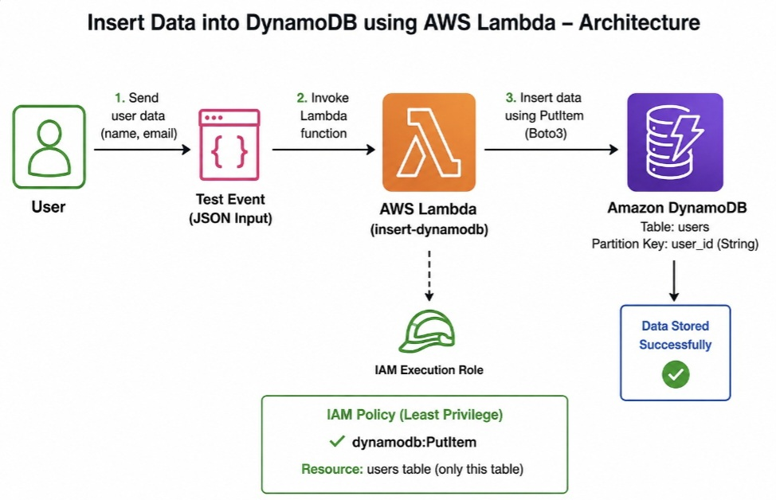

#### AWS Lambda and DynamoDB Data Insertion Project


### 1\. Project overview

This project demonstrates how to insert data into an Amazon DynamoDB table using AWS Lambda. The Lambda function executes Python code to receive data and store it in DynamoDB without requiring you to manage servers.

The project introduces serverless computing, NoSQL databases, and event-driven cloud architecture using AWS services.

### 2\. Objectives

* Create a DynamoDB table to store application data.

* Develop an AWS Lambda function using Python.

* Configure Lambda permissions to access DynamoDB.

* Insert data into DynamoDB using the `put_item()` operation.

* Understand serverless computing and AWS IAM roles.

### 3\. AWS services and technologies


AWS Lambda

Runs the Python function when it receives an event, without managing servers.


Amazon DynamoDB

A managed NoSQL database that stores the inserted records.


AWS IAM

Controls the permissions that allow Lambda to write records to DynamoDB.

Other technologies: Python, Boto3 (AWS SDK for Python), and the AWS Management Console.

### 4\. Architecture

## 🏗️ Architecture



### 5\. How the project works

* Create a DynamoDB table and define its partition key.

* Create an AWS Lambda function using Python.

* Configure the Lambda execution role with permission to write to the table.

* Write code using Boto3's `put_item()` method.

* Create a test event containing sample data.

* Run the Lambda function and verify that the item appears in DynamoDB.

### 6\. Sample Python code

This example assumes the DynamoDB table has a partition key named `id` of type String.

```python

import json
import os
import boto3

dynamodb = boto3.resource("dynamodb")
table = dynamodb.Table(os.environ["TABLE_NAME"])

def lambda_handler(event, context):
    item = {
        "id": str(event["id"]),
        "name": event["name"],
        "email": event["email"]
    }

    table.put_item(Item=item)

    return {
        "statusCode": 200,
        "body": json.dumps({
            "message": "Data inserted successfully",
            "item": item
        })
    }
```

Set the Lambda environment variable `TABLE_NAME` to your actual DynamoDB table name. Configure an IAM role with `dynamodb:PutItem` permission for that table.

Example test event:

```json
{
  "id": "101",
  "name": "Pratiksha",
  "email": "pratiksha@example.com"
}
```

### 7\. Expected output

* Lambda executes successfully.

* The function returns a success response.

* A new item appears in the DynamoDB table with the provided `id`, `name`, and `email`.

### 8\. Advantages

* No server management.

* Automatically scales with demand.

* Pay-per-use pricing within the applicable AWS service pricing model.

* Easy integration between AWS services.

* Useful for learning cloud automation and serverless application development.

### 9\. Future enhancements

* Add API Gateway for HTTP-based data insertion.

* Validate input data and handle errors.

* Add CloudWatch logging and monitoring.

* Use Terraform to provision the AWS resources.

* Add update, read, and delete operations.


Conclusion:This project demonstrates secure and serverless data insertion using AWS Lambda and DynamoDB, with IAM least-privilege permissions for controlled table access.

Author

Pratiksha Pawar 
